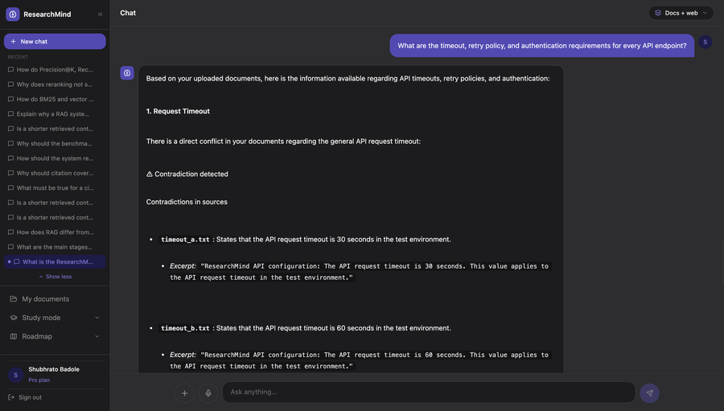
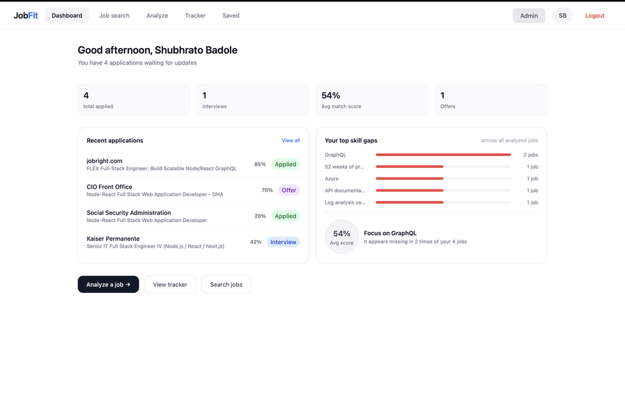

  

  <a href="https://linkedin.com/in/shubhrato">LinkedIn</a> ·
  <a href="https://shubhrato.dev">Portfolio</a> ·
  <a href="mailto:bshubhrato@gmail.com">bshubhrato@gmail.com</a>

I build AI products end to end: agentic RAG systems, full-stack apps and secure backends. I measure what I build. ResearchMind AI ships with its own 100-question retrieval benchmark, and JobFit's Redis cache took repeat requests from about 4 s to 5 ms.

B.Tech in Computer Science (Cyber Security), 2026. My security background, including an internship with the State Cyber Crime Investigation Unit, shapes how I design auth, validation and data handling.

**Open to** full-stack, AI/RAG and backend engineering roles.

## Featured projects

<table>
  <tr>
    <td width="50%" valign="top">
      
      <h3><a href="https://github.com/shubhrato-badole/researchmind-ai">ResearchMind AI</a></h3>
      
Agentic RAG assistant that answers from your own documents, with sources.

      <ul>
        <li>LangGraph agent that asks for approval before searching the web. Answers cite their sources and flag contradictions between documents.</li>
        <li>Hybrid retrieval (BM25 + vector, RRF fusion) benchmarked against vector-only and reranked retrieval on a 100-question set. Hybrid reached Recall@5 of 97.5% on the development split.</li>
        <li>Full stack: React 19, TypeScript, FastAPI, PostgreSQL, Redis, ChromaDB, S3. Razorpay freemium with Redis quotas.</li>
      </ul>
      Python · FastAPI · LangGraph · ChromaDB · React 19 · TypeScript
    </td>
    <td width="50%" valign="top">
      
      <h3><a href="https://github.com/shubhrato-badole/JobFit">JobFit</a> · <a href="https://job-fit-murex.vercel.app">Live demo</a></h3>
      
Upload a resume, get a match score for any job and the exact skills you're missing.

      <ul>
        <li>Gemini match scores (0-100) with skill-gap analysis, an AI career assistant, job search and a Kanban application tracker.</li>
        <li>Redis caching cut repeat-request latency from about 4 s to 5 ms (50 concurrent requests).</li>
        <li>httpOnly JWT cookies with 30-minute and 7-day rotation, bcrypt, parameterised SQL and rate limiting. Dockerized behind Nginx, deployed on Vercel and Render.</li>
      </ul>
      React · Node.js · Express · PostgreSQL · Redis · Gemini · Docker
    </td>
  </tr>
</table>

**More**

- **[Spur RAG Pipeline](https://github.com/shubhrato-badole/spur)**: a RAG microservice built without LangChain or LlamaIndex. Sentence-aware chunker (500 characters, 100 overlap), `gemini-embedding-001` at 768 dimensions, cosine search with pgvector.
- **[Portfolio](https://github.com/shubhrato-badole/shubhrato-portfolio)**: interactive React, TypeScript, Vite and Tailwind site with a typewriter entry gate and a circuit puzzle that unlocks my résumé.

## Experience

- **Cyber Cell Intern**, State Cyber Crime Investigation Unit, Govt. of Maharashtra (Jan-Jun 2026). Analyzed 20-30 phishing and financial-fraud complaints a week and contributed to a monitoring portal built with Python, FastAPI, PostgreSQL and React.
- **Digital Forensics Intern**, Crypto Forensic Technology (Jun-Jul 2025). Verified evidence integrity with SHA-256 hashing and wrote forensic reports aligned with legal admissibility standards.

## Tech stack

| | |
|---|---|
| **Languages** | Python, TypeScript, JavaScript, SQL, Bash |
| **AI / RAG** | LangGraph, LangChain, LangSmith, hybrid search (BM25 + RRF), BGE reranker, embeddings, pgvector, ChromaDB, Gemini API |
| **Backend** | FastAPI, Node.js, Express, REST APIs, JWT |
| **Frontend** | React 19, Tailwind CSS, Vite |
| **Data** | PostgreSQL, Redis, MongoDB |
| **Cloud and DevOps** | Docker, Nginx, GitHub Actions, AWS (EC2, S3), Vercel, Render |
| **Security** | OWASP Top 10, SHA-256, digital forensics |

## Currently

- Data structures and algorithms for technical interviews
- System design for production-scale AI and RAG systems
- AI security: LLM vulnerabilities and the OWASP LLM Top 10

Certified Cyber Forensic Examiner (2025) · Deloitte Cybersecurity Virtual Experience (2024)

The best way to reach me is [bshubhrato@gmail.com](mailto:bshubhrato@gmail.com).
